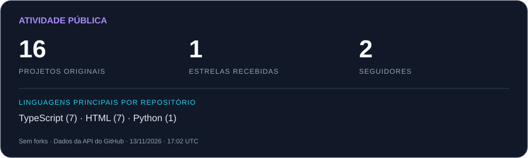

**Interfaces bem cuidadas. Dados conectados. Ideias em prática.**

## Olá, Me chamo Gustavo 👋

Sou desenvolvedor **Full Stack** e estudante de **Ciência da Computação na Universidade Católica de Pernambuco (UNICAP)**. Construo aplicações web conectando interfaces, dados e regras de negócio.
- 🛍️ Desenvolvo sites, lojas virtuais e aplicações para negócios e profissionais.
- ⚙️ Trabalho com **React, Next.js, TypeScript, Tailwind CSS e Supabase** em projetos reais.
- 🔎 Trago uma experiência de estágio em homologação, com foco em qualidade e validação de dados.
- 🌱 Aprendo construindo, investigando problemas e colaborando com outras pessoas.

## Tecnologias & ferramentas

  

## Projetos em destaque

| Projeto | O que construí | Tecnologias | Explore |
| :--- | :--- | :--- | :--- |
| **🛍️ Dona Sil** | Loja de moda feminina com catálogo, carrinho, finalização pelo WhatsApp e painel de produtos e estoque. | Next.js · TypeScript · Tailwind CSS · Supabase | [Código](https://github.com/gustavosergio/DonaSil) · [Site](https://donasilmodafeminina.com.br) |
| **✦ Portfólio pessoal** | Apresentação dos meus projetos e trajetória, em português e inglês, com temas claro e escuro e layout responsivo. | Next.js · React · TypeScript · Tailwind CSS | [Código](https://github.com/gustavosergio/gustavosergio.github.io) · [Site](https://gustavosergio.github.io/) |

  <a href="https://github.com/gustavosergio?tab=repositories">Ver todos os repositórios →</a>

## GitHub em números

  

Dados públicos atualizados diariamente pelo GitHub Actions. As linguagens consideram a linguagem principal de cada repositório original.

## Cada contribuição conta 🐍

<picture>
  <source media="(prefers-color-scheme: dark)" srcset="https://raw.githubusercontent.com/gustavosergio/gustavosergio/output/github-snake-dark.svg" />
  <source media="(prefers-color-scheme: light)" srcset="https://raw.githubusercontent.com/gustavosergio/gustavosergio/output/github-snake.svg" />
  
</picture>

## Vamos conversar?

Tem um projeto em mente ou quer trocar ideias sobre desenvolvimento web?

**[LinkedIn](https://www.linkedin.com/in/gustavo-s%C3%A9rgio)** · **[E-mail](mailto:gustavosergiocordeiro@gmail.com)** · **[Instagram](https://www.instagram.com/gustavosergio.dev/)** · **[Portfólio](https://gustavosergio.github.io/)**

  Aprendendo. Construindo. Conectando.

